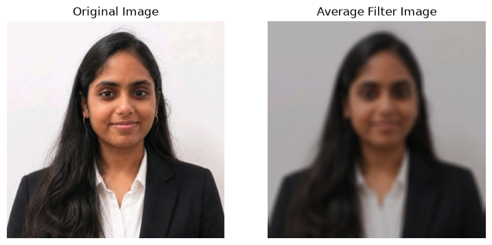
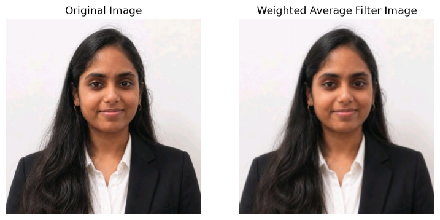
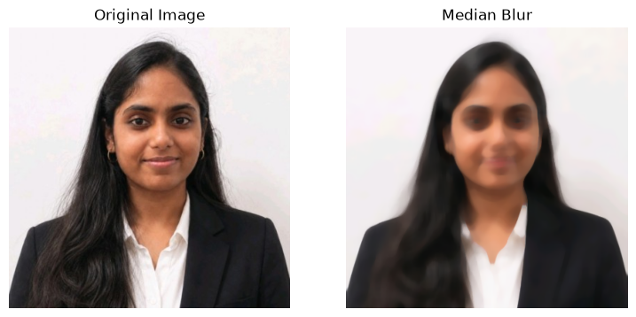
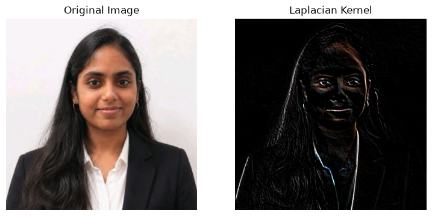
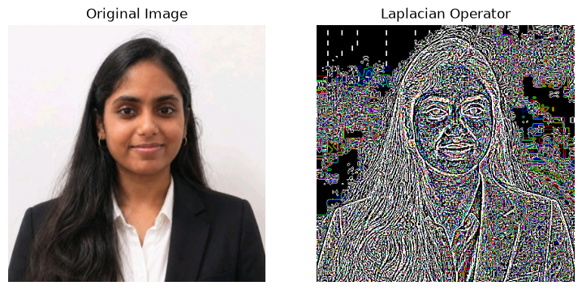

# EXP-5: Image Smoothing and Sharpening Using OpenCV

## Experiment Details

- **Name:** Ramitha Chowdary S
- **Register Number:** 212224240130

## Aim

Blur ramitha.png with a few smoothing filters, then sharpen it and run a Laplacian on the grayscale photo.

## Software Required

- Anaconda
- Python 3
- Jupyter Notebook
- OpenCV
- NumPy
- Matplotlib

## Algorithm

**Step 1:** Read the photo and convert it to RGB.

**Step 2:** Blur it with a 7 by 7 average filter.

**Step 3:** Blur it again with a weighted 3 by 3 kernel.

**Step 4:** Apply a Gaussian blur.

**Step 5:** Apply a median blur.

**Step 6:** Sharpen it with a small kernel.

**Step 7:** Turn the photo gray and run cv2.Laplacian on it.

## Program

#### 1.

```python
import cv2
import matplotlib.pyplot as plt
import numpy as np
image1=cv2.imread("ramitha.png")
image2=cv2.cvtColor(image1,cv2.COLOR_BGR2RGB)
kernel=np.ones((11,11),np.float32)/169
image3=cv2.filter2D(image2,-1,kernel)
plt.figure(figsize=(9,9))
plt.subplot(1,2,1)
plt.imshow(image2)
plt.title("Original Image")
plt.axis("off")
plt.subplot(1,2,2)
plt.imshow(image3)
plt.title("Average Filter Image")
plt.axis("off")
plt.show()
```

#### 2.

```python
kernel1=np.array([[1,2,1],[2,4,2],[1,2,1]])/16
image2=cv2.cvtColor(image1,cv2.COLOR_BGR2RGB)
image3=cv2.filter2D(image2,-1,kernel1)
plt.subplot(1,2,1)
plt.imshow(image2)
plt.title("Original Image")
plt.axis("off")
plt.subplot(1,2,2)
plt.imshow(image3)
plt.title("Weighted Average Filter Image")
plt.axis("off")
plt.show()
```

#### 3.

```python
gaussian_blur=cv2.GaussianBlur(image2,(33,33),0,0)
plt.subplot(1,2,1)
plt.imshow(image2)
plt.title("Original Image")
plt.axis("off")
plt.subplot(1,2,2)
plt.imshow(gaussian_blur)
plt.title("Gaussian Blur")
plt.axis("off")
plt.show()
```

#### 4.

```python
median=cv2.medianBlur(image2,13)
plt.figure(figsize=(9,9))
plt.subplot(1,2,1)
plt.imshow(image2)
plt.title("Original Image")
plt.axis("off")
plt.subplot(1,2,2)
plt.imshow(median)
plt.title("Median Blur")
plt.axis("off")
plt.show()
```

#### 5.

```python
kernel2=np.array([[-1,-1,-1],[2,-2,1],[2,1,-1]])
image3=cv2.filter2D(image2,-1,kernel2)
plt.subplot(1,2,1)
plt.imshow(image2)
plt.title("Original Image")
plt.axis("off")
plt.subplot(1,2,2)
plt.imshow(image3)
plt.title("Laplacian Kernel")
plt.axis("off")
plt.show()
```

#### 6.

```python
laplacian=cv2.Laplacian(image2,cv2.CV_64F)
plt.subplot(1,2,1)
plt.imshow(image2)
plt.title("Original Image")
plt.axis("off")
plt.subplot(1,2,2)
plt.imshow(laplacian)
plt.title("Laplacian Operator")
plt.axis("off")
plt.show()
```

## Output












## Result

The photo was smoothed with average, weighted, Gaussian and median filters, then sharpened, and the Laplacian was taken on the grayscale version.
