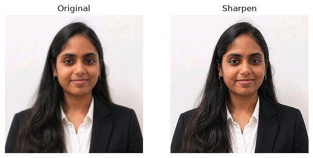

# EXP-5: Image Smoothing and Sharpening Using OpenCV

## Experiment Details

- **Name:** Ramitha Chowdary S
- **Register Number:** 212224240130

## Aim

Blur ramitha.png with a few smoothing filters, then sharpen it and run a Laplacian on the grayscale photo.

## Software Required

- Anaconda
- Python 3
- Jupyter Notebook
- OpenCV
- NumPy
- Matplotlib

## Algorithm

**Step 1:** Read the photo and convert it to RGB.

**Step 2:** Blur it with a 7 by 7 average filter.

**Step 3:** Blur it again with a weighted 3 by 3 kernel.

**Step 4:** Apply a Gaussian blur.

**Step 5:** Apply a median blur.

**Step 6:** Sharpen it with a small kernel.

**Step 7:** Turn the photo gray and run cv2.Laplacian on it.

## Program

#### 1. Read the photo

```python
import cv2
import numpy as np
import matplotlib.pyplot as plt

bgr = cv2.imread("ramitha.png")
img = cv2.cvtColor(bgr, cv2.COLOR_BGR2RGB)

def beside(changed, title, gray=False):
    plt.figure(figsize=(8, 4))
    plt.subplot(1, 2, 1)
    if gray:
        plt.imshow(changed[0], cmap="gray")
    else:
        plt.imshow(img)
    plt.title("Original")
    plt.axis("off")
    plt.subplot(1, 2, 2)
    if gray:
        plt.imshow(changed[1], cmap="gray")
    else:
        plt.imshow(changed)
    plt.title(title)
    plt.axis("off")
    plt.show()
```

#### 2. Average filter

```python
beside(cv2.blur(img, (7, 7)), "Average")
```

#### 3. Weighted average

```python
weights = np.array([[1, 2, 1], [2, 4, 2], [1, 2, 1]], np.float32) / 16
beside(cv2.filter2D(img, -1, weights), "Weighted average")
```

#### 4. Gaussian blur

```python
beside(cv2.GaussianBlur(img, (9, 9), 0), "Gaussian")
```

#### 5. Median filter

```python
beside(cv2.medianBlur(img, 7), "Median")
```

#### 6. Sharpen

```python
sharp = np.array([[0, -1, 0], [-1, 5, -1], [0, -1, 0]], np.float32)
beside(cv2.filter2D(img, -1, sharp), "Sharpen")
```

#### 7. Laplacian on grayscale

```python
gray = cv2.cvtColor(bgr, cv2.COLOR_BGR2GRAY)
lap = cv2.convertScaleAbs(cv2.Laplacian(gray, cv2.CV_64F))
beside((gray, lap), "Laplacian", gray=True)
```

## Output

### i) Average


### ii) Weighted average


### iii) Gaussian


### iv) Median


### v) Sharpen



### vi) Laplacian


## Result

The photo was smoothed with average, weighted, Gaussian and median filters, then sharpened, and the Laplacian was taken on the grayscale version.
